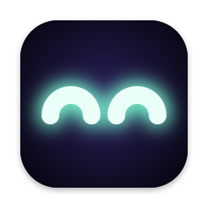
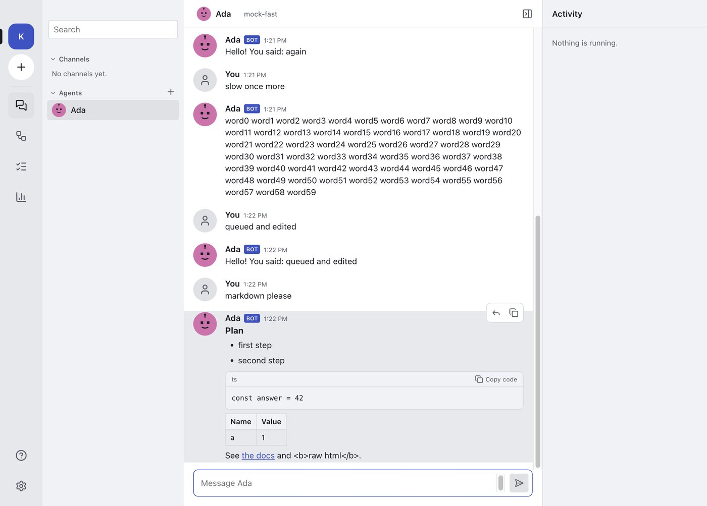
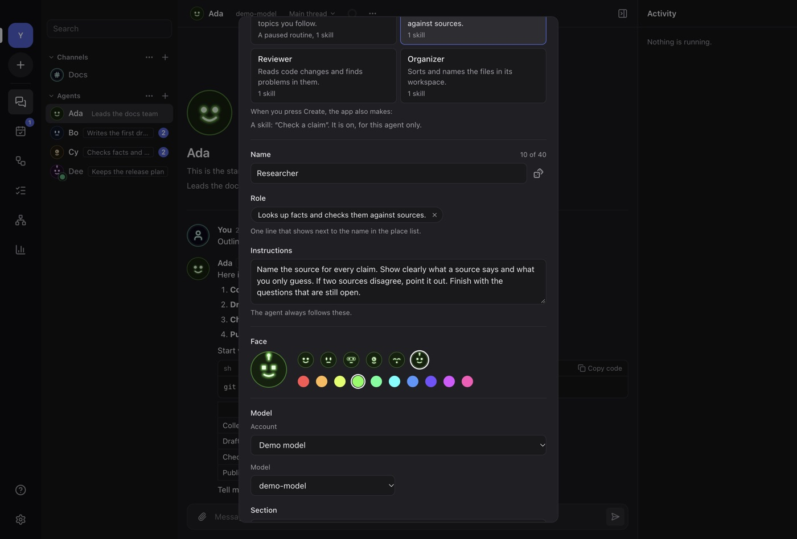
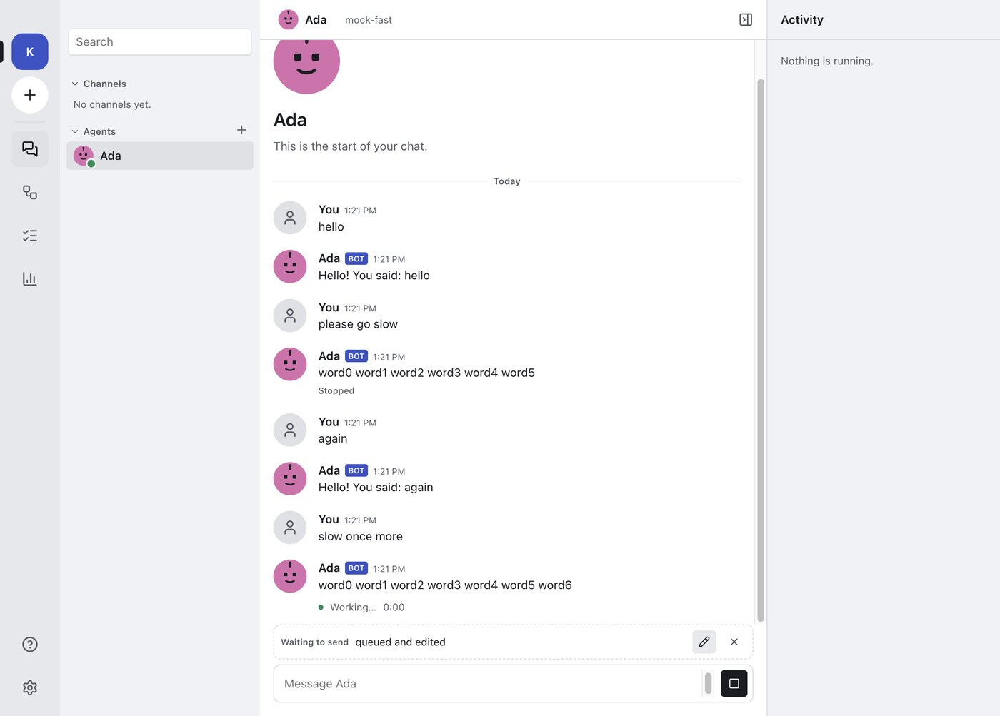
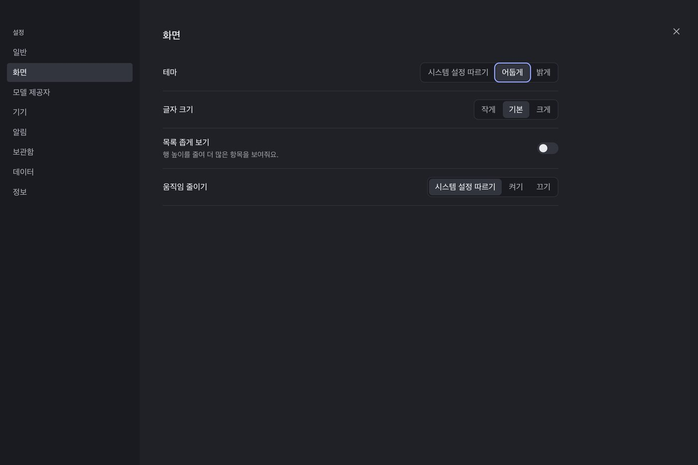
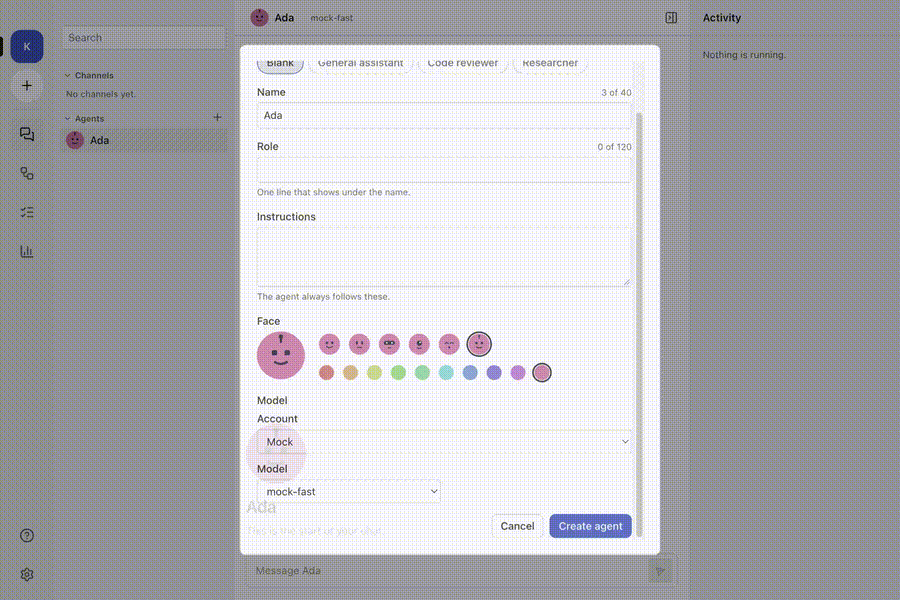

<div align="center">



# ROBot

**Run a small team of AI agents on your own computer, the way you work with people on a chat server.**

[](https://github.com/zereight/robot/actions/workflows/ci.yml)
[](https://github.com/zereight/robot/actions/workflows/release.yml)
[](LICENSE)


English · 한국어 interface

</div>

<p align="center">
  
</p>

ROBot (Rapid Open Bot) is a desktop app, with a phone app to come, where each AI agent is a
member with a face, a name, a role, a model and a workspace. You talk to one agent in a direct
chat. Later you put several agents in a channel and give them one job together.

Your conversations, files and settings stay on your computer. Only the model provider you
choose receives the messages you send to it.

> **Status: early alpha.** Milestone M1 (agents and direct chat) is in progress. Builds are
> unsigned pre-releases. Expect changes to data and settings between versions.

## Contents

- [Features](#features)
- [Download](#download)
- [Screenshots](#screenshots)
- [Development](#development)
- [Architecture](#architecture)
- [Testing](#testing)
- [Release](#release)
- [Clean-room project](#clean-room-project)
- [Roadmap](#roadmap)
- [Contributing](#contributing)
- [License](#license)

## Features

### Available now

| Area | What you can do |
| --- | --- |
| **Agents** | Create an agent from a template (general assistant, code reviewer, researcher) or from blank. Pick one of 6 faces and 10 colours, or upload a picture. Edit, duplicate, archive, restore and delete. Each agent has its own workspace folder. |
| **Model accounts** | Connect OpenAI, Anthropic or any OpenAI-compatible endpoint with an API key. The key is checked before it is saved, and it goes to the system keychain. Pick a model and an effort level per agent. Disconnect or remove an account at any time. |
| **Direct chat** | Replies stream in. Stop a reply at any time; the partial reply stays and is marked. Messages you send while the agent works wait in a queue that you can edit. Reply to a message, jump to the quote and back. Edit your last message. Retry a failed reply. Markdown with code copy buttons, tables and links. Thinking folds into one line. |
| **Window** | Server rail, place list with search (Cmd/Ctrl+K), collapsible sections, unread counts, a working dot, a resizable list, and an activity panel. Narrow windows get a compact rail. |
| **Settings** | English or Korean (or follow the system), dark, light or system theme, three text sizes, compact list, reduce motion, start at login, workspace folder, third-party licences. |
| **Motion** | Calm enter and exit motion, every motion under 300 ms. Reduce motion turns all of it off. |
| **Local data** | One SQLite database in your app data folder. A reply is saved while it streams, so a crash loses at most the last part. |

### Planned

Channels with a lead agent that splits work, a tasks page, workspace tools with approvals and a
browser, agent memory, routines, workflows, a phone app, and notifications. See the
[roadmap](#roadmap).

## Download

Get the latest build from [Releases](https://github.com/zereight/robot/releases).

| Platform | File |
| --- | --- |
| macOS, Apple silicon | `ROBot-<version>-mac-arm64.dmg` |
| macOS, Intel | `ROBot-<version>-mac-x64.dmg` |
| Windows x64 | `ROBot-<version>-win-x64.exe` |
| Linux x64 | `ROBot-<version>-linux-x86_64.AppImage` or `-linux-amd64.deb` |

Each release has a `SHA256SUMS.txt` file. Check a download with
`shasum -a 256 -c SHA256SUMS.txt --ignore-missing`.

**The builds are not signed yet.**

- macOS: Control-click the app and choose **Open** the first time, or run
  `xattr -dr com.apple.quarantine /Applications/ROBot.app`.
- Windows: if SmartScreen warns, choose **More info**, then **Run anyway**.

### Where your data is

| System | Folder |
| --- | --- |
| macOS | `~/Library/Application Support/ROBot` |
| Windows | `%APPDATA%\ROBot` |
| Linux | `~/.config/ROBot` |

API keys are not in this folder. They are in the macOS Keychain, the Windows Credential Manager,
or the Secret Service on Linux.

## Screenshots

| | |
| --- | --- |
|  |  |
| New agent | Stop, streaming and the queue |
|  |  |
| Dark theme | Motion |

The end-to-end tests make these pictures from the real app.

## Development

### Requirements

- [Bun](https://bun.sh) 1.4 or later
- Node.js 24 (only for Playwright)
- macOS, Windows or Linux. Linux needs the Electron system libraries and a Secret Service
  (for example `gnome-keyring`).

### Commands

```sh
bun install          # dependencies and the Electron binary
bun run dev          # run the desktop app with hot reload
bun run lint         # Biome
bun run format       # Biome, with fixes
bun run typecheck    # TypeScript, every workspace
bun run test         # unit tests (bun test)
bun run e2e          # build, then Playwright drives the real app
bun run dist         # package for this computer into dist/desktop
```

If your shell sets `ELECTRON_RUN_AS_NODE=1`, unset it before `bun run dev`. The end-to-end
harness does this for you.

### Repository layout

```text
apps/desktop/
  src/main/          Electron main process: Effect services, RPC, providers, SQLite
  src/preload/       The narrow bridge the window can call
  src/renderer/      SolidJS interface: shell, chat, agents, providers, settings
  e2e/               Playwright tests, mock model provider, harness
  resources/         App icon
  electron-builder.yml
packages/shared/     Types, schemas, en and ko catalogues, shared rules
specs/               Behaviour specs: the only source for implementation
docs/                Spec questions, provenance, release process
```

## Architecture

```text
┌──────────── renderer (SolidJS) ────────────┐
│ shell · chat · agents · settings           │
│ every string from the en / ko catalogues   │
└───────────────┬────────────────────────────┘
                │ typed RPC + events (contextIsolation, sandbox)
┌───────────────┴──────────── main (Effect) ─┐
│ Settings · Agents · Providers · Chat       │
│ Places · Activity · Secrets · EventBus     │
├──────────────┬──────────────┬──────────────┤
│ node:sqlite  │ OS keychain  │ model APIs   │
│ (WAL)        │              │ (SSE)        │
└──────────────┴──────────────┴──────────────┘
```

- **Main process.** Each area is an [Effect](https://effect.website) service with a layer. A test
  runtime swaps the platform, secrets and network for fakes, so unit tests cover the real
  services.
- **RPC.** The renderer calls named methods over one IPC channel. The main process decodes every
  input with a schema before a handler runs. Events (`chat.message`, `agents.changed`, …) go the
  other way.
- **Chat.** One worker per agent streams the reply, saves it every 500 ms and when it ends, and
  sends the next queued message. Replies still marked as streaming at start-up become stopped.
- **Security.** Context isolation, a sandboxed preload, a strict content security policy, no new
  windows, no navigation. Links open in the system browser, http, https and mailto only. Markdown
  never renders raw HTML.
- **Text.** Every visible string has a key in English and Korean. A test checks that the two
  catalogues have the same keys, and the end-to-end suite checks the Korean interface for
  untranslated words.

## Testing

| Layer | Tool | What it covers |
| --- | --- | --- |
| Unit | `bun test` | Services against an in-memory database, SSE parsing, provider requests, schemas, contrast of every theme colour (WCAG 4.5:1), catalogue parity, licence list |
| End to end | Playwright with Electron | The real app against a local mock provider: every M1 flow, restarts, both languages, narrow windows, motion limits |
| Packaged | Same suite, `ROBOT_E2E_APP` | The installed app on macOS arm64 and x64, Windows x64 and Linux x64 |

End-to-end runs write screenshots, a report and a motion video under `build/e2e`. CI keeps them
as an artifact for each run.

## Release

A version tag builds and tests all four apps, then makes a draft release:

```sh
git checkout -b release/v0.2.0
bun run version 0.2.0        # sets apps/desktop/package.json
# open a PR, squash-merge when green, then:
git checkout main && git pull
git tag v0.2.0 && git push origin v0.2.0
```

Each packaged app runs the whole end-to-end suite before it is attached. A version with a
suffix, such as `0.2.0-beta.1`, becomes a pre-release. The full process, the dry run and the
signing plan are in [docs/release.md](docs/release.md).

## Clean-room project

ROBot is written from an empty tree. Two roles keep it clean:

- **Spec authors** write behaviour specs in [`specs/`](specs/README.md): what the user sees and
  does, never code.
- **Implementers** build only from those specs and public documentation, and never look at other
  apps' code.

Unclear spec points and the choices made for them are in
[docs/spec-questions.md](docs/spec-questions.md). Every merged change has a line in
[docs/provenance.md](docs/provenance.md). The rules are in [CLEANROOM.md](CLEANROOM.md).

## Roadmap

| Milestone | Scope | State |
| --- | --- | --- |
| **M1** | Window, agents, direct chat, providers, settings, local data | Done in alpha. Next: M2 |
| **M2** | Channels, split work, tasks page | Done in alpha.3 |
| **M3** | Workspace tools, approvals, browser, memory | Done in alpha.3 |
| **M4** | Routines and workflows | Done in alpha.3 |
| **M5** | Phone app (Expo) and desktop link | Deferred until the desktop app is finished and in use |
| **M6** | Notifications and status island | Done (next release) |

## Contributing

1. Read [CLEANROOM.md](CLEANROOM.md) and [AGENTS.md](AGENTS.md), and state your role in the PR.
2. One branch and one pull request per change, with the PR template filled in.
3. Interface text goes in both catalogues, `packages/shared/src/i18n/en.ts` and `ko.ts`.
4. Run `bun run lint`, `bun run typecheck`, `bun run test` and the end-to-end tests for the area
   you changed.
5. Dependencies must use an MIT-compatible licence (MIT, ISC, BSD, Apache-2.0).
6. Do not add AI co-author trailers to commits.

## License

[MIT](LICENSE) © 2026 zereight
