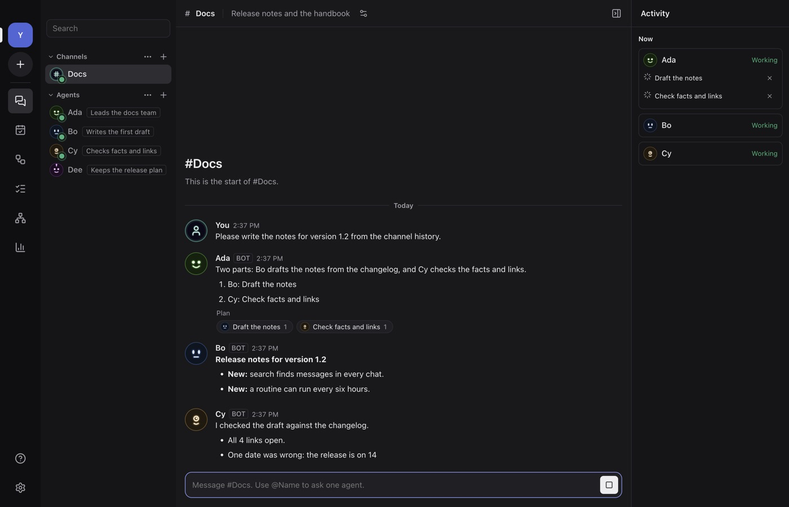
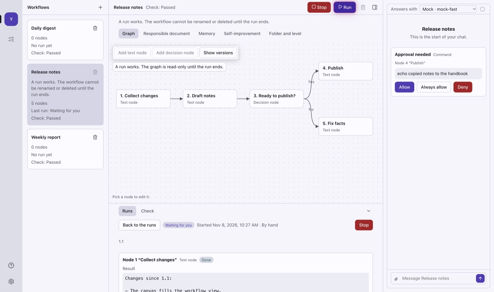
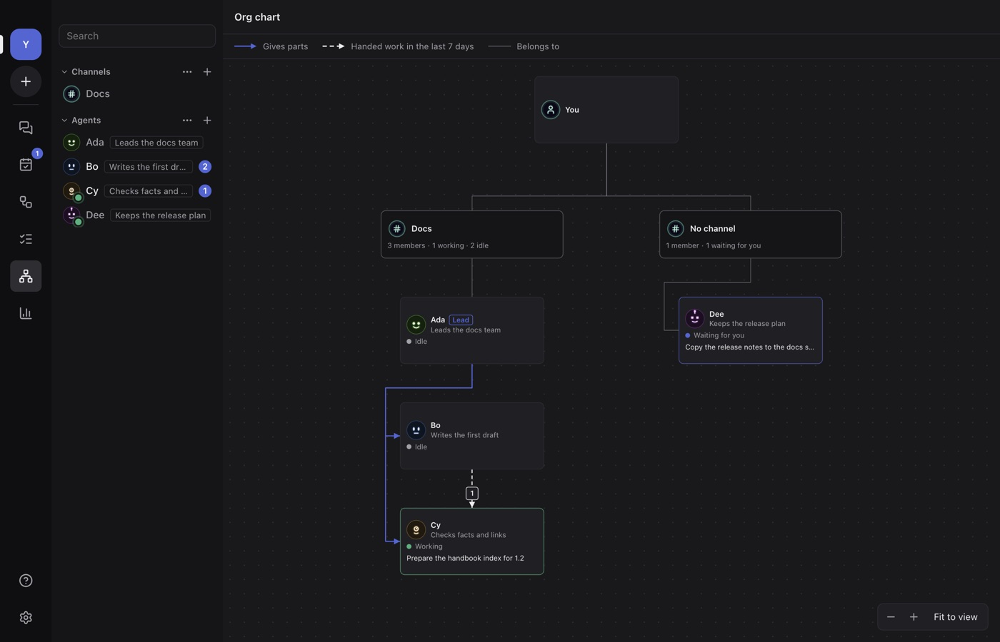
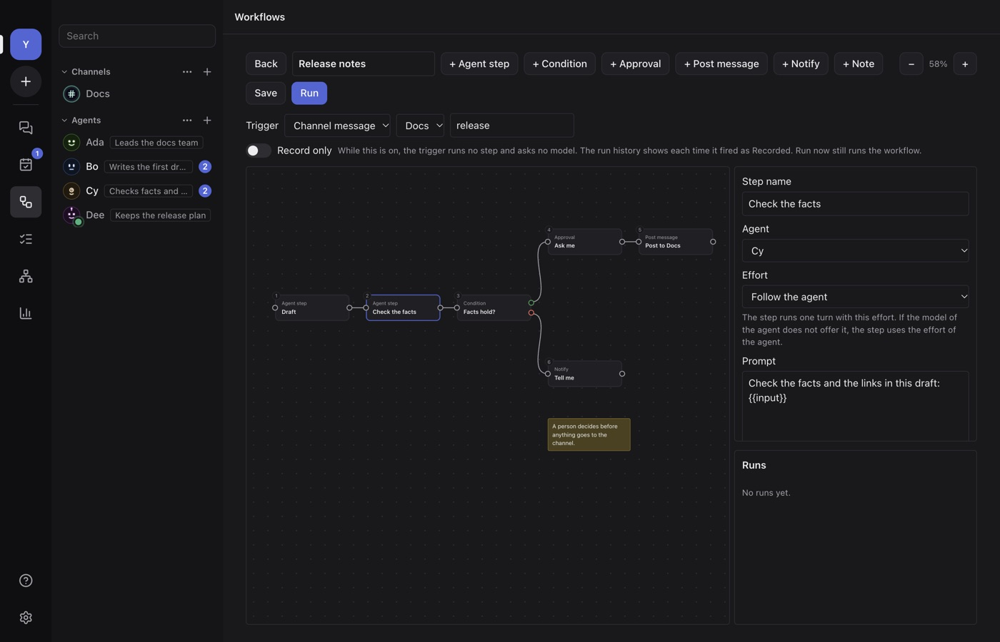
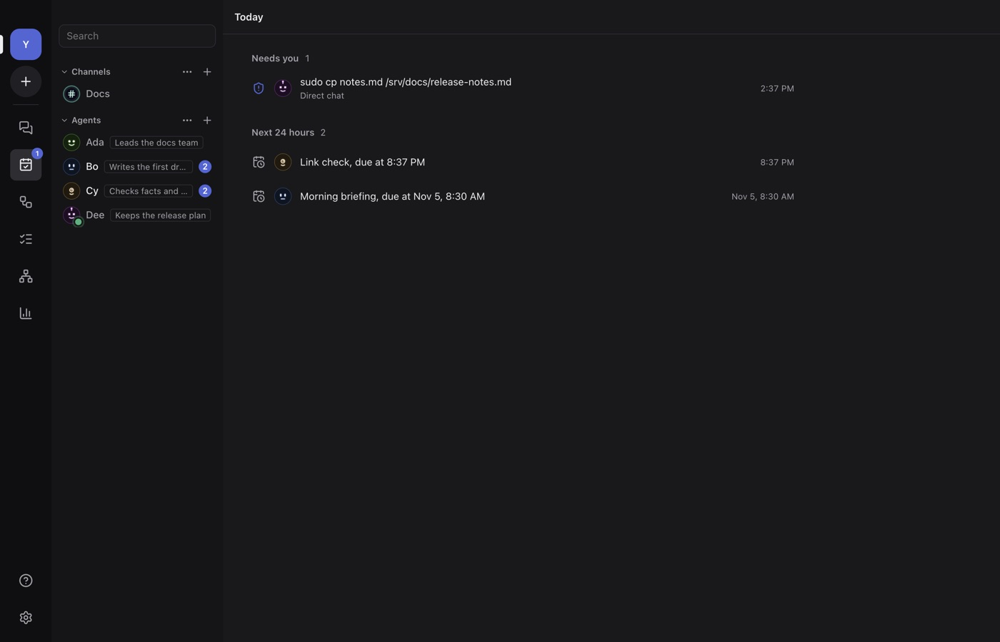
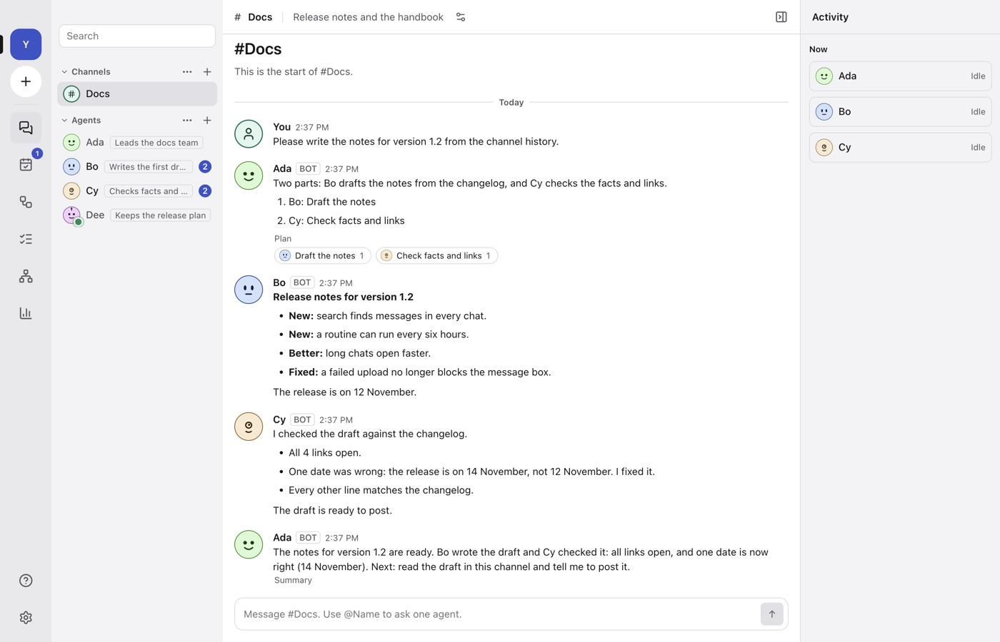
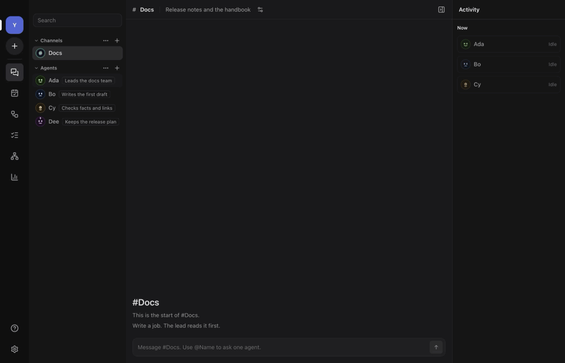

<div align="center">


# ROBot

**Run a small team of AI agents on your own computer, the way you work with people on a chat server.**

[](https://github.com/zereight/robot/actions/workflows/ci.yml)
[](https://github.com/zereight/robot/actions/workflows/release.yml)
[](LICENSE)
-lightgrey)

English · 한국어 interface

</div>

<p align="center">
  
</p>

ROBot (Rapid Open Bot) is a desktop app for Macs with Apple silicon. Each AI agent is a member
with a face, a name, a role, a model and a workspace. You talk to one agent in a direct chat. You
put several agents in a channel and give them one job together. A phone app for iOS and Android
pairs with your computer, so that you can follow and direct your agents when you are away.

Your conversations, files and settings stay on your computer. Only the model provider you
choose receives the messages you send to it. The app sends no analytics and no failure reports.

ROBot does not train or change a model. An agent gets better at its job through things that you
can see and edit: its instructions, its memory, its knowledge, and the skills that you save.

> **Status: early alpha.** The desktop app has the features below. Builds are unsigned
> pre-releases. The phone app runs from source with Expo and has no store build yet. Expect
> changes to data and settings between versions.

## Contents

- [Features](#features)
- [Screenshots](#screenshots)
- [Download](#download)
- [Phone app](#phone-app)
- [Development](#development)
- [Architecture](#architecture)
- [Testing](#testing)
- [Release](#release)
- [Roadmap](#roadmap)
- [Contributing](#contributing)
- [License](#license)

## Features

### Available now

| Area | What you can do |
| --- | --- |
| **Agents** | Create an agent from a starter (Assistant, Briefer, Researcher, Reviewer, Organizer) or from blank. A starter fills the name, role and instructions, and can also make a paused routine and a skill. Pick one of 6 faces and 10 colours, or upload a picture. A face follows the theme: it glows in the dark theme and is a tinted disc in the light theme. Give an agent a role line from a list or a new one. Edit, duplicate, archive, restore and delete. Each agent has its own workspace folder, and its instructions keep a history that you can restore. Export agents to one file, and import them with a review before anything is made. |
| **Model accounts** | Use the subscription you already have: sign in to Claude Code (Claude plan), Codex (ChatGPT plan) or Muse Code (Meta account), use the models that you set up in pi or opencode, or use Cursor on this computer (`cursor-agent`, then `cursor-agent login` or `CURSOR_API_KEY`). ROBot runs that program with your sign-in. It never reads or stores your tokens and it removes API key variables from the program's environment, so the plan pays (not for pi and opencode, which have their own models and billing). Cursor keeps `CURSOR_API_KEY`, because that key is the Cursor account. Or connect OpenAI, Anthropic or any OpenAI-compatible endpoint with an API key, which goes to the system keychain. Add more than one Claude Code account, each with its own sign-in. The app shows if a program is missing or signed out, and has **Check again** and **Repair**. Pick a model and an effort level (None to Ultra) per agent. A model shows only the levels that it lists. Hide models you do not use. |
| **Direct chat** | Replies stream in. Stop a reply at any time; the partial reply stays and is marked. Messages you send while the agent works join the turn or wait in a queue that you can edit. Reply to a message and jump to the quote. Edit your last message. Retry a failed reply. Markdown with code copy buttons, tables and links; a picture from the web loads only when you press **Load image**. Thinking folds into one line. Attach files. Use threads, fork a thread from a message, hand a chat over to another agent, and search all messages. A context meter shows how full the chat is, and **Compact** (also automatic) shortens it. Type `/` to run a saved skill. |
| **Channels** | Put several agents in a channel and pick a lead. The lead splits a job into parts, and each part has a done test. The members work on their parts. The lead checks each result against its test and posts one summary. Mention one agent with `@Name`, or all of them with `@all`. Turn on review of parts, so that you accept a part or ask for changes. A part that cannot be done shows as **Blocked**. The activity panel shows the plan steps and the members at work. An optional small decision model (off by default) can pick one member for a job, so that the lead does not have to. |
| **Tasks** | Every agent turn is a task. The Tasks page lists them with their state and times, and a work record for each. Stop, retry, run next, and set how many agents work at once. A task that waits for you keeps waiting after a restart. |
| **Tools and approvals** | Agents read and write files in their workspace, run shell commands, search and fetch the web, and ask you questions. Four permission levels: Read only, Ask for risky steps, Ask for everything, Full access. An approval card has **Allow once**, **Always allow for this agent** and **Deny**. Saved rules and an action log are in Settings, Permissions. Each agent can have a browser: it shows in the activity panel, and you take control and give it back. Text that comes from the web is marked as outside content, and it cannot widen a permission. Agents can use keys that you saved without ever seeing them. |
| **Memory and knowledge** | An agent saves facts to its memory at once, or asks you first. You edit, search and undo memory items. An agent also writes linked articles with sources in its workspace, cites them, and checks them for changes. A change list lets you undo a change. |
| **Skills** | Save instructions as a skill and call it with a slash. Make a skill from a finished task, an article or a memory item, or teach one: do a task in the browser once and ROBot drafts the skill. |
| **Connections** | Add outside tools for agents over MCP (a program, or a web address). Test a connection, set approvals for its tools, and review a tool when it changes. |
| **Routines** | Run a job on a schedule: once, every N minutes, daily, weekly or by a cron line. Or watch a file, a folder, a command or a tool for changes. See the next runs in a list, a week or a month. Missed and skipped runs are recorded. A routine pauses after 3 failed runs in a row, and a server holds at most 50. |
| **Workflows** | Build a graph of steps on a canvas: agent, condition (text or a model answers), approval, post to a place, and notify. Start it by hand, by a schedule or by a channel message. Read the history of runs. Export and import workflows. |
| **Today and Org chart** | **Today** shows what needs you, what went wrong, what is done today and what runs in the next 24 hours. **Org chart** shows you, the channels, their members and leads, the state of each agent, and the work that agents handed to each other. |
| **Devices and sync** | Link another computer or a phone with a QR code or a 6-digit code. The link is encrypted, and works on one network or through your own VPN. A linked computer shows as a server in the rail. With a switch that you set for each device, that device can also create and change agents and channels. Two computers can sync agents, chats, memory, routines and workflows. |
| **Notifications** | System notifications by kind, with mutes. A status island on the screen shows agents at work and lets you answer an approval. Keep the computer awake while agents work. |
| **Teams link** (experimental) | Talk to one agent or one channel from a Microsoft Teams chat. The app reads the chat in a page where you signed in by hand, and writes the answers to the same chat. It is off until you turn it on. It has been checked against a stand-in page only, not against the real Teams page. |
| **Window and settings** | Server rail, place list with search (Cmd+K), your own sections, unread counts, a working dot, role badges, a resizable list and an activity panel. English or Korean (or follow the system), dark, light or system theme, three text sizes, reduce motion, start at login, workspace folder, third-party licences. |
| **Motion** | Calm enter and exit motion, every motion under 300 ms. Reduce motion turns all of it off. |
| **Local data** | One SQLite database in your app data folder. A reply is saved while it streams, so a crash loses at most the last part. Keys go to the system keychain. Export and import your data; keys and secrets stay out of the export. |

### Not built yet

These parts have a spec and no code yet: separate profiles on one computer, one board for all
agents, voice, token-saving switches, shared folders with file claims, own copies of a Git
repository for parts, web hook triggers, outside programs that call ROBot, a backup model, ACP
programs, a menu bar item, the quiet line, the workflow assistant, and computer use. See the
[roadmap](#roadmap).

## Screenshots

| | |
| --- | --- |
|  |  |
| A channel at work | An approval card |
|  |  |
| Org chart | Workflow editor |
|  |  |
| Today | New agent, with starters |
|  |  |
| Light theme | A job from start to end |

The pictures show a team of four agents. A scripted stand-in model writes the replies, not a real
model. The end-to-end tooling makes the pictures from the real app (see
[Make the pictures](#make-the-pictures)).

## Download

Get the newest build from [Releases](https://github.com/zereight/robot/releases). `main` can be
ahead of the newest release.

| Platform | File |
| --- | --- |
| macOS, Apple silicon (M1 or later) | `ROBot-<version>-mac-arm64.dmg` |

There is no app for an Intel Mac, for Windows or for Linux.

Each release has a `SHA256SUMS.txt` file. Check a download with
`shasum -a 256 -c SHA256SUMS.txt --ignore-missing`.

**The builds are not signed yet.**

- macOS: Control-click the app and choose **Open** the first time, or run
  `xattr -dr com.apple.quarantine /Applications/ROBot.app`.

### Where your data is

`~/Library/Application Support/ROBot`

API keys are not in this folder. They are in the macOS Keychain.

## Phone app

The phone app is for iOS and Android, with the same screens on both. It runs no agents. It needs
a Mac that runs ROBot.

- Pair with a computer: scan the QR code on the computer, or type the address and the 6-digit
  code. One phone can pair with more than one computer.
- Read the places of a computer, open a direct chat or a channel, send messages and files, and
  stop an agent.
- Answer approval and question cards, and see what waits for you in one list.
- See the org chart as a list, and change the language and theme.

There is no store build and no release build yet. To run it from source, use Expo:

```sh
bun install
bun run --cwd apps/mobile start     # then open the app in Expo Go on a phone or a simulator
```

`apps/mobile/e2e/run-ios.ts` runs the flows on the iOS Simulator with Maestro. Its notes are at
the top of that file.

## Development

### Requirements

- [Bun](https://bun.sh) 1.4 or later
- [Rust](https://rustup.rs) through rustup. `rust-toolchain.toml` sets the version, and rustup
  gets it at the first build
- Node.js 24 (only for Playwright)
- A Mac with Apple silicon (M1 or later)

### Commands

```sh
bun install          # dependencies, the Electron binary and the Git hooks
bun run dev          # run the desktop app with hot reload
bun run lint         # Biome
bun run format       # Biome, with fixes
bun run typecheck    # TypeScript, every workspace
bun run test         # unit tests (bun test, files in parallel)
bun run test:fast    # unit tests without the slow files of test-slow-files.txt
bun run test:slow    # only the slow files; CI runs these, pre-push runs them when touched
bun run check        # lint, typecheck, unit tests and the host checks in one go
bun run host:check   # host: rustfmt, clippy and cargo test
bun run e2e          # build, then Playwright drives the real app
bun run dist         # package for this computer into dist/desktop
bun run sizes        # size of the built files against the baseline (docs/performance.md)
bun run perf         # times, CPU use and memory by hand (docs/performance.md)
```

`dev`, `build`, `e2e` and `dist` build the host first (`bun run --cwd apps/desktop build:host`).

If your shell sets `ELECTRON_RUN_AS_NODE=1`, unset it before `bun run dev`. The end-to-end
harness does this for you.

### Git hooks

`bun install` sets `core.hooksPath` to `.githooks`. Two hooks run on your computer:

- `pre-commit` runs Biome on the staged files. It writes no fixes.
- `pre-push` runs lint, typecheck, `test:fast` and the host checks in parallel, plus the
  slow test files touched by the push. It does not run the end-to-end suite. A push that
  changes only specs, top-level docs or CI config is not checked, and a push that changes
  nothing under `host/` runs `cargo fmt --check` instead of the full host checks. When
  `cargo` is not in PATH, it skips the host checks and says so; CI still runs them.

`git commit --no-verify` and `git push --no-verify` skip them. CI runs the same checks, so a skipped
hook only moves the failure to the pull request.

### Repository layout

```text
host/                The host program in Rust: the work of the app, apart from the windows
apps/desktop/
  src/main/          Electron main process: Effect services, RPC, providers, runtimes,
                     device link, sync, connections, Teams link, SQLite
  src/preload/       The narrow bridge the window can call
  src/renderer/      SolidJS interface: shell, chat, channels, agents, workflows, org chart,
                     settings and more
  e2e/               Playwright tests, mock model provider, harness, README pictures
  scripts/           Release checks, licence list, size and speed measures
  resources/         App icon: icon.svg is the source of icon.png
  electron-builder.yml
apps/mobile/
  app/               Expo Router screens
  src/               State, chat, Markdown, org chart list, theme and interface parts
  e2e/               Maestro flows and the runner for the iOS Simulator
  assets/            Phone icons: each .svg is the source of the .png of the same name
packages/shared/     Types, schemas, en and ko catalogues, shared rules
packages/link/       The device link: identity, pairing, encrypted messages
packages/phone/      The phone's side of the link: hub, places, cache
packages/teams-bridge/  A stand-alone Teams reader for tests (not part of the app)
specs/               Behaviour specs: the only source for implementation
docs/                Spec questions, release process, formats, measures
```

### App icon

The app mark is two smiling eyes that glow in the dark. The SVG files are the source. After a
change, export the PNG files again, for example with [resvg](https://github.com/linebender/resvg):

```sh
resvg -w 1024 -h 1024 apps/desktop/resources/icon.svg apps/desktop/resources/icon.png
resvg -w 256 -h 256 apps/desktop/resources/icon.svg .github/assets/icon.png
for f in icon icon-foreground icon-background icon-monochrome; do
  resvg -w 1024 -h 1024 apps/mobile/assets/$f.svg apps/mobile/assets/$f.png
done
```

The phone icon (`icon.png`) and the back layer of the Android icon (`icon-background.png`) must
have no transparency. Remove the alpha channel after the export, for example with
`magick <file> -alpha off <file>`.

### Make the pictures

The pictures in this file come from the real app. One Playwright file builds a team of four
agents against a scripted stand-in model, and saves a PNG of each screen to `build/e2e/readme`:

```sh
README_SHOTS=1 bun run --cwd apps/desktop e2e e2e/readme-shots.spec.ts
```

The file does nothing without `README_SHOTS`, so the normal suite skips it. Make the JPEG files
of the README (1400 px wide) from the PNG files, for example with the `sips` tool of macOS:

```sh
sips -s format jpeg -s formatOptions 82 -Z 1400 build/e2e/readme/chat.png --out .github/assets/chat.jpg
```

The file also films the channel job. With `ffmpeg` in PATH, the harness writes
`build/e2e/videos/readme-demo.gif`, and that file is `.github/assets/demo.gif`. Without it, the
frames stay in `build/e2e/videos/readme-demo-frames`. Look at each picture before you commit it.

## Architecture

```text
┌──────────── renderer (SolidJS) ────────────┐
│ shell · chat · channels · agents · pages   │
│ every string from the en / ko catalogues   │
└───────────────┬────────────────────────────┘
                │ typed RPC + events (contextIsolation, sandbox)
┌───────────────┴──────────── main (Effect) ─┐
│ Agents · Chat · Channels · Tasks · Tools   │
│ Providers · Runtimes · Routines            │
│ Workflows · Memory · Knowledge · Skills    │
│ Connections · Devices · Sync · Notifier    │
├──────────────┬──────────────┬──────────────┤
│ node:sqlite  │ OS keychain  │ model APIs   │
│ (WAL)        │              │ (SSE)        │
└──────────────┴──────────────┴──────────────┘
                │ one JSON line per request and per answer (stdin / stdout)
┌───────────────┴──────────── host (Rust) ───┐
│ app.licenses · keychain (secrets)          │
└────────────────────────────────────────────┘
```

- **Host.** The work of the app moves from the main process to `host/`, a Rust program, one
  method at a time, until the main process only keeps the windows. The main process starts the
  host at the first call, sends it the methods in its list of host methods, and restarts it after
  a stop. The host ends when its input closes, so it never outlives the app.
- **Keys.** API keys and tokens live in the system keychain, and only the host reads and writes
  it (`robot-host secrets get|set|remove`). The main process runs this short command and waits
  for it, and keeps the values that it read in memory.
- **Main process.** Each area is an [Effect](https://effect.website) service with a layer. A test
  runtime swaps the platform, secrets and network for fakes, so unit tests cover the real
  services.
- **RPC.** The renderer calls named methods over one IPC channel. The main process decodes every
  input with a schema before a handler runs. Events (`chat.message`, `agents.changed`, …) go the
  other way.
- **Chat and tasks.** One worker per agent streams the reply, saves it every 500 ms and when it
  ends, and sends the next queued message. Replies still marked as streaming at start-up become
  stopped. An agent that uses a vendor program (Claude Code, Codex, Muse Code, pi, opencode,
  Cursor) runs that program, and the app shows its steps and approvals in the same cards. Cursor
  shows its steps. A headless run cannot ask before a step, so the permission level sets the mode
  of the program instead.
- **Device link.** A computer that you link is a server. The window and the phone ask it for
  places and messages over an encrypted link, and it pushes changes back. Two computers that sync
  each keep a full copy, and send change records to each other.
- **Security.** Context isolation, a sandboxed preload, a strict content security policy, no new
  windows, no navigation. Links open in the system browser, http, https and mailto only. Markdown
  never renders raw HTML.
- **Text.** Every visible string has a key in English and Korean. A test checks that the two
  catalogues have the same keys, and the end-to-end suite checks the Korean interface for
  untranslated words.

## Testing

| Layer | Tool | What it covers |
| --- | --- | --- |
| Unit | `bun test` | Services against an in-memory database, SSE parsing, provider requests, schemas, contrast of every theme colour (WCAG 4.5:1), catalogue parity, licence list, style rules |
| Host | `cargo test`, clippy | The Rust host: protocol, keychain, licences |
| End to end | Playwright with Electron | The real app against a local mock provider: every flow of the specs, restarts, two copies that link and sync, both languages, narrow windows, motion limits |
| Phone | Maestro on the iOS Simulator | Pairing, conversation, approvals, settings and the org chart (by hand, not in CI) |
| Packaged | Same suite, `ROBOT_E2E_APP` | The installed app on macOS arm64 |

End-to-end runs write screenshots, a report and a motion video under `build/e2e`. The Release
workflow keeps the report of the packaged app as an artifact.

Both suites run in parallel. Unit test files run in separate processes. Each end-to-end test
starts its own copy of the app with its own data folder. Tests that run two copies of the app ask
the system for free ports (`apps/desktop/e2e/ports.ts`) and give every worker its own port for
the network name service, so they run in parallel, next to other runs, and next to an open ROBot.
Some hosted test machines block multicast; the test of nearby computers then checks the rest of
its flow without the list. The number of end-to-end workers is half of the CPU cores; set
`ROBOT_E2E_WORKERS` to change it. On CI a failed test is retried once; the report marks a test
that passed on the retry as flaky.

The end-to-end suite runs on your computer only. The `CI` workflow does not run it, neither on a
pull request nor on a push to `main`. It runs the host checks, lint, typecheck and unit tests, and
the size check. Run `bun run e2e` for the area you changed before you open a pull request. The
only CI run of the suite is the Release workflow, against the packaged app (see below).

```sh
bun run e2e                                        # whole suite
cd apps/desktop && bunx playwright test e2e/s5-chat.spec.ts   # one file, without a new build
ROBOT_E2E_WORKERS=1 bun run e2e                    # one test at a time
```

## Release

A version tag builds and tests the app, then makes a draft release:

```sh
git checkout -b release/v0.2.0
bun run version 0.2.0        # sets apps/desktop/package.json
# open a PR, squash-merge when green, then:
git checkout main && git pull
git tag v0.2.0 && git push origin v0.2.0
```

The packaged app runs the whole end-to-end suite before it is attached, and a script checks the
disk image and the zip file (version, arm64 only, host program, signature). A version with a
suffix, such as `0.2.0-beta.1`, becomes a pre-release. The full process, the dry run and the
signing plan are in [docs/release.md](docs/release.md).

## Roadmap

The [spec index](specs/README.md) lists every milestone and the slices of each.
[docs/spec-changes.md](docs/spec-changes.md) says what each slice built and what it left out.
This table says where the app stands.

| Milestone | Scope | State |
| --- | --- | --- |
| **M1** | Window, agents, direct chat, providers, settings, local data | Done |
| **M2** | Channels, split work, tasks page | Done |
| **M3** | Workspace tools, approvals, browser, memory | Done |
| **M4** | Routines and workflows | Done |
| **M5** | Device link, sync between computers, phone app | Done on the desktop. The phone app has pairing, places, chat, approvals and the org chart; it runs from source and has no store build |
| **M6** | Notifications and status island | Done |
| **M7 on** | Slices of later milestones | In progress, slice by slice. Built: decision model and fast pick, user sections, agent and workflow files with a review before an import, knowledge, skills, connections, permission rules and action log, limits of a task, runtime states, review of parts, messages during a turn, outside content, changes from the chat, saved secrets, task times, watch routines, teach a task, message search, Today, memory control, verdicts in the check, starters, threads, compact, the task queue, pictures from the web, sensitive places, handover, make a skill, effort levels and the model list, the Teams link, the org chart, the role label |
| **Planned** | No code yet | Separate profiles on one computer, one board for all agents, voice, token-saving switches, shared folders with file claims, own copies of a Git repository for parts, web hook triggers, outside programs that call ROBot, a backup model, ACP programs, a menu bar item, the quiet line, the workflow assistant, computer use |

## Contributing

1. Read [AGENTS.md](AGENTS.md). Unclear spec points and the choices made for them are in
   [docs/spec-questions.md](docs/spec-questions.md).
2. One branch and one pull request per change, with the PR template filled in.
3. Interface text goes in both catalogues, `packages/shared/src/i18n/en.ts` and `ko.ts`.
4. Run `bun run lint`, `bun run typecheck`, `bun run test` and the end-to-end tests for the area
   you changed.
5. Dependencies must use an MIT-compatible licence (MIT, ISC, BSD, Apache-2.0).
6. Do not add AI co-author trailers to commits.

## License

[MIT](LICENSE) © 2026 zereight
