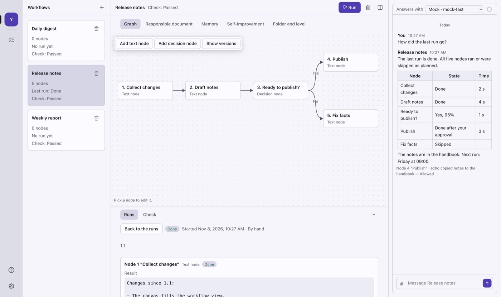
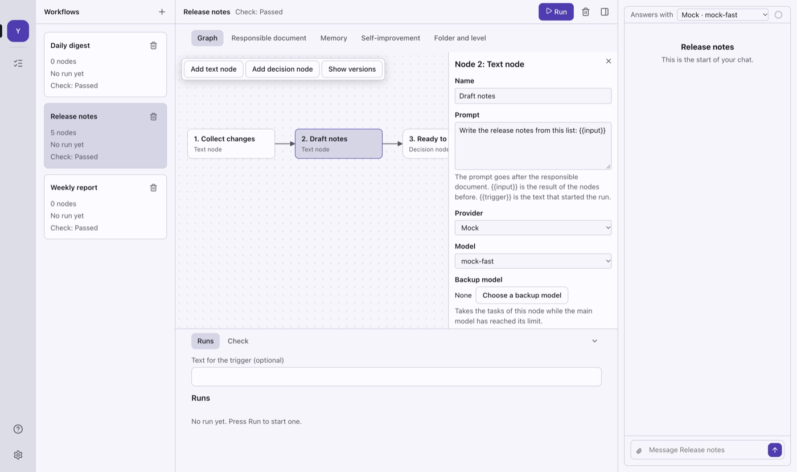
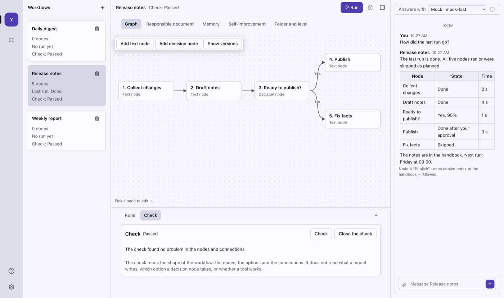
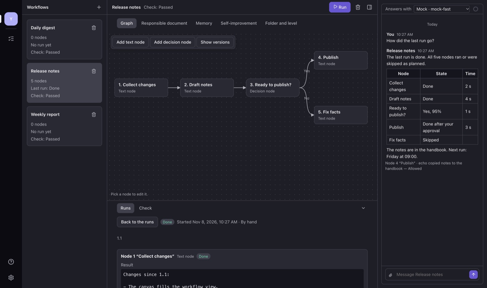

<div align="center">


# ROBot

**Build workflows of AI models on your own computer, run them, and see every step.**

[](https://github.com/zereight/robot/actions/workflows/ci.yml)
[](https://github.com/zereight/robot/actions/workflows/release.yml)
[](LICENSE)
-lightgrey)

English · 한국어 interface

</div>

<p align="center">
  
</p>

ROBot (Rapid Open Bot) is a desktop app for Macs with Apple silicon. A workflow is a graph of
nodes. A text node sends a prompt to a model that you pick. A decision node chooses one of its
options. You start a run, and the nodes run in a fixed order. Each workflow also has a
responsible document, one chat and one memory.

The app is a studio. The workflow list, the canvas, the runs and the chat show in one window, so
you see progress, approvals and results without opening another page.

Your workflows, chats and settings stay on your computer. Only the model provider you choose
receives the prompts you send to it. The app sends no analytics and no failure reports.

ROBot does not train or change a model. A workflow gets better through things that you can see
and edit: its responsible document, its memory, its nodes and the skills that you save.

> **Status: early alpha.** The app moved from agents and channels to workflows in November 2026.
> Builds are unsigned pre-releases. Expect changes to data and settings between versions.

## Contents

- [Features](#features)
- [Screenshots](#screenshots)
- [Download](#download)
- [Phone app](#phone-app)
- [Development](#development)
- [Architecture](#architecture)
- [Testing](#testing)
- [Release](#release)
- [Roadmap](#roadmap)
- [Contributing](#contributing)
- [License](#license)

## Features

### Available now

| Area | What you can do |
| --- | --- |
| **Studio** | One window: a server rail, the workflow list, the canvas, a run strip with runs and the check, and the chat of the open workflow. The canvas fills the workflow view, the node panel docks beside it, and the run strip folds. |
| **Workflows** | Make, rename and delete workflows. Each card in the list shows its nodes, its last run and its check. A workflow that runs cannot be renamed or deleted. |
| **Graph** | Add text nodes and decision nodes, connect them, and connect each option of a decision node to its own branch. Every change that is not a move keeps the graph as a version. |
| **Text nodes** | A name, a prompt, a provider, a model and a reasoning level. `{{input}}` is the result of the nodes before, and `{{trigger}}` is the text that started the run. A backup model can take over while the main model is at its limit. |
| **Decision nodes** | A decision model gives a probability to each option. The node takes the option that reaches the threshold. When no option does, a card in the chat asks you to pick. |
| **Runs** | Press Run, with an optional trigger text. The run view shows the state, the reason and the result of each node. Stop a run at any time; the part result stays. The Tasks page shows the queue, the slots and each task, with Run next and retry. |
| **Check** | The check reads the shape of the workflow as a TLA model and reports what can go wrong: nodes that wait for each other so that no run can end, and a node that never runs. |
| **Chat** | One chat per workflow, where the responsible document answers. Replies stream in and render Markdown. Stop a reply, edit the last message, mark a message as unread, and fold the tool steps. A meter shows how full the context is, and a long chat compacts into a summary. The chat can read the graph and the runs, and propose a change or a new workflow that you allow. |
| **Responsible document** | A text that says who answers for the workflow, its character and its limits. Edit it, and go back to an earlier version from its history. |
| **Memory and self-improvement** | A workflow keeps facts between runs. After a run, it can propose a change to its memory, its document or its graph. You accept or reject each proposal, and undo it from the change log. |
| **Model accounts** | Use the subscription you already have through Claude Code, Codex, Muse Code, pi, opencode or Cursor. Or connect an API key for OpenAI, Anthropic or another OpenAI-compatible provider. |
| **Tools and approvals** | Nodes read and write files in the workflow folder, run shell commands, use a browser, and ask you questions. Five permission levels, from Read only to Full access, plus your own Allow and Deny rules. An action log records each step. |
| **Connections** | Add outside tools over MCP, as a program or a web address. Test a connection, set approvals for its tools, and review a tool when it changes. |
| **Skills and secrets** | Save instructions as a skill and call it with a slash. Save keys and passwords that nodes use and the model never sees. |
| **Shared folders** | Two workflows that use one folder claim the files they change, so they do not write over each other. |
| **Devices** | Link another computer or a phone with a QR code or a 6-digit code. The link is encrypted. A linked computer shows as a server in the rail. |
| **Settings** | English or Korean, a dark and a light theme, three text sizes, and the decision model. Reduce motion stops every motion. |
| **Local data** | One SQLite database in your app data folder. A reply is saved while it streams, so a crash loses at most the last part. Keys go to the macOS Keychain. |

### Not built yet

These areas have a spec and no finished code yet: schedule triggers, sync between two computers,
notifications and the status island, knowledge, profiles, voice, token-saving switches, outside
programs that call ROBot, the Teams link, test devices, setup actions, and workflows on the phone.
See the [roadmap](#roadmap).

## Screenshots

| | |
| --- | --- |
|  |  |
| The node panel | An approval during a run |
|  |  |
| The check | Dark theme |

<p align="center">
  
</p>

The pictures show one workflow, Release notes. A scripted stand-in model writes the results and
the replies, not a real model. The end-to-end tooling makes the pictures from the real app (see
[Make the pictures](#make-the-pictures)).

## Download

Get the newest build from [Releases](https://github.com/zereight/robot/releases). `main` can be
ahead of the newest release.

| Platform | File |
| --- | --- |
| macOS, Apple silicon (M1 or later) | `ROBot-<version>-mac-arm64.dmg` |

There is no app for an Intel Mac, for Windows or for Linux.

Each release has a `SHA256SUMS.txt` file. Check a download with
`shasum -a 256 -c SHA256SUMS.txt --ignore-missing`.

**The builds are not signed yet.**

- macOS: Control-click the app and choose **Open** the first time, or run
  `xattr -dr com.apple.quarantine /Applications/ROBot.app`.

### Where your data is

`~/Library/Application Support/ROBot`

API keys are not in this folder. They are in the macOS Keychain.

## Phone app

The phone app is for iOS and Android, with the same screens on both. It runs no workflows. It
needs a Mac that runs ROBot.

- Pair with a computer: scan the QR code on the computer, or type the address and the 6-digit
  code. One phone can pair with more than one computer.
- See each paired computer and the state of its connection.
- Change the language and the theme.

The workflows of a computer come to the phone in a later slice. There is no store build and no
release build yet. To run it from source, use Expo:

```sh
bun install
bun run --cwd apps/mobile start     # then open the app in Expo Go on a phone or a simulator
```

## Development

### Requirements

- [Bun](https://bun.sh) 1.4 or later
- [Rust](https://rustup.rs) through rustup. `rust-toolchain.toml` sets the version, and rustup
  gets it at the first build
- Node.js 24 (only for Playwright)
- A Mac with Apple silicon (M1 or later)

### Commands

```sh
bun install          # dependencies, the Electron binary and the Git hooks
bun run dev          # run the desktop app with hot reload
bun run lint         # Biome
bun run format       # Biome, with fixes
bun run typecheck    # TypeScript, every workspace
bun run test         # unit tests (bun test, files in parallel)
bun run test:fast    # unit tests without the slow files of test-slow-files.txt
bun run test:slow    # only the slow files; CI runs these, pre-push runs them when touched
bun run check        # lint, typecheck, unit tests and the host checks in one go
bun run host:check   # host: rustfmt, clippy and cargo test
bun run e2e          # build, then Playwright drives the real app
bun run dist         # package for this computer into dist/desktop
bun run sizes        # size of the built files against the baseline, by hand (docs/performance.md)
```

`dev`, `build`, `e2e` and `dist` build the host first (`bun run --cwd apps/desktop build:host`).

If your shell sets `ELECTRON_RUN_AS_NODE=1`, unset it before `bun run dev`. The end-to-end
harness does this for you.

### Git hooks

`bun install` sets `core.hooksPath` to `.githooks`. Three hooks run on your computer:

- `commit-msg` takes AI co-author trailers out of the commit message, such as
  `Co-authored-by: Cursor <cursoragent@cursor.com>` (see `AGENTS.md`). A trailer for a person
  stays. A tool can add one after you write the message, and `git commit --amend` keeps it, so
  the hook cleans the message at the last point before the commit is made. It never stops a
  commit.
- `pre-commit` runs Biome on the staged files. It writes no fixes.
- `pre-push` runs lint, typecheck, `test:fast` and the host checks in parallel, plus the
  slow test files touched by the push. It does not run the end-to-end suite. A push that
  changes only specs, top-level docs or CI config is not checked, and a push that changes
  nothing under `host/` runs `cargo fmt --check` instead of the full host checks. When
  `cargo` is not in PATH, it skips the host checks and says so; CI still runs them.

`git commit --no-verify` and `git push --no-verify` skip them. CI runs the same checks, so a skipped
hook only moves the failure to the pull request.

### Repository layout

```text
host/                The host program in Rust: the work of the app, apart from the windows
apps/desktop/
  src/main/          Electron main process: Effect services, RPC, providers, runtimes, runs,
                     the check, device link, connections, SQLite
  src/preload/       The narrow bridge the window can call
  src/renderer/      SolidJS interface: studio shell, workflows, chat, tasks, settings and
                     more
  e2e/               Playwright tests, mock model provider, harness, README pictures
  scripts/           Release checks, licence list, size and speed measures
  resources/         App icon: icon.svg is the source of icon.png
  electron-builder.yml
apps/mobile/
  app/               Expo Router screens
  src/               State, pairing, theme and interface parts
  e2e/               Maestro flows and the runner for the iOS Simulator
  assets/            Phone icons: each .svg is the source of the .png of the same name
packages/shared/     Types, schemas, en and ko catalogues, shared rules
packages/link/       The device link: identity, pairing, encrypted messages
packages/phone/      The phone's side of the link: hub and cache
packages/teams-bridge/  A stand-alone Teams reader for tests (not part of the app)
specs/               Behaviour specs: the only source for implementation
docs/                Spec questions, proposals, release process, formats, measures
```

### App icon

The app mark is two smiling eyes that glow in the dark. The SVG files are the source. After a
change, export the PNG files again, for example with [resvg](https://github.com/linebender/resvg):

```sh
resvg -w 1024 -h 1024 apps/desktop/resources/icon.svg apps/desktop/resources/icon.png
resvg -w 256 -h 256 apps/desktop/resources/icon.svg .github/assets/icon.png
for f in icon icon-foreground icon-background icon-monochrome; do
  resvg -w 1024 -h 1024 apps/mobile/assets/$f.svg apps/mobile/assets/$f.png
done
```

The phone icon (`icon.png`) and the back layer of the Android icon (`icon-background.png`) must
have no transparency. Remove the alpha channel after the export, for example with
`magick <file> -alpha off <file>`.

### Make the pictures

The pictures in this file come from the real app. One Playwright file builds the Release notes
workflow against a scripted stand-in model, runs it, and saves a PNG of each screen to
`build/e2e/readme`:

```sh
bun run --cwd apps/desktop build
cd apps/desktop && README_SHOTS=1 bunx playwright test e2e/readme-shots.spec.ts
```

The file does nothing without `README_SHOTS`, so the normal suite skips it. Make the JPEG files
of the README (1400 px wide) from the PNG files, for example with the `sips` tool of macOS:

```sh
for f in studio node-panel approval check studio-dark; do
  sips -s format jpeg -s formatOptions 82 -Z 1400 build/e2e/readme/$f.png --out .github/assets/$f.jpg
done
```

The file also films the run. With `ffmpeg` in PATH, the harness writes
`build/e2e/videos/readme-demo.gif`, and that file is `.github/assets/demo.gif`. Without it, the
frames stay in `build/e2e/videos/readme-demo-frames`. Look at each picture before you commit it.

## Architecture

```text
┌──────────── renderer (SolidJS) ────────────┐
│ studio · canvas · runs · chat · settings   │
│ every string from the en / ko catalogues   │
└───────────────┬────────────────────────────┘
                │ typed RPC + events (contextIsolation, sandbox)
┌───────────────┴──────────── main (Effect) ─┐
│ Workflows · Runs · Check · Chat · Tasks    │
│ Providers · Runtimes · Decision · Tools    │
│ Memory · Proposals · Skills · Secrets      │
│ Connections · Devices · File claims        │
├──────────────┬──────────────┬──────────────┤
│ node:sqlite  │ OS keychain  │ model APIs   │
│ (WAL)        │              │ (SSE)        │
└──────────────┴──────────────┴──────────────┘
                │ one JSON line per request and per answer (stdin / stdout)
┌───────────────┴──────────── host (Rust) ───┐
│ app.licenses · keychain (secrets)          │
└────────────────────────────────────────────┘
```

- **Host.** The work of the app moves from the main process to `host/`, a Rust program, one
  method at a time, until the main process only keeps the windows. The main process starts the
  host at the first call, sends it the methods in its list of host methods, and restarts it after
  a stop. The host ends when its input closes, so it never outlives the app.
- **Keys.** API keys and tokens live in the system keychain, and only the host reads and writes
  it (`robot-host secrets get|set|remove`). The main process runs this short command and waits
  for it, and keeps the values that it read in memory.
- **Main process.** Each area is an [Effect](https://effect.website) service with a layer. A test
  runtime swaps the platform, secrets and network for fakes, so unit tests cover the real
  services.
- **RPC.** The renderer calls named methods over one IPC channel. The main process decodes every
  input with a schema before a handler runs. Events (`chat.message`, `settings.changed`, …) go
  the other way.
- **Runs and tasks.** A run makes one task for each node that an input reaches, in the order of
  the graph. A text node streams its reply, and the reply is saved every 500 ms and when it ends.
  A node that uses a vendor program (Claude Code, Codex, Muse Code, pi, opencode, Cursor) runs
  that program, and the app shows its steps and approvals in the same cards. A headless run
  cannot ask before a step, so the permission level sets the mode of the program instead.
- **Check.** The check writes the graph as a TLA model and checks it in a worker with
  [tla-ts](https://www.npmjs.com/package/tla-ts).
- **Device link.** A computer that you link is a server. The window and the phone ask it for
  data over an encrypted link, and it pushes changes back.
- **Security.** Context isolation, a sandboxed preload, a strict content security policy, no new
  windows, no navigation. Links open in the system browser, http, https and mailto only. Markdown
  never renders raw HTML.
- **Text.** Every visible string has a key in English and Korean. A test checks that the two
  catalogues have the same keys, and the end-to-end suite checks the Korean interface for
  untranslated words.

## Testing

| Layer | Tool | What it covers |
| --- | --- | --- |
| Unit | `bun test` | Services against an in-memory database, SSE parsing, provider requests, schemas, contrast of every theme colour (WCAG 4.5:1), catalogue parity, licence list, style rules |
| Host | `cargo test`, clippy | The Rust host: protocol, keychain, licences |
| End to end | Playwright with Electron | The real app against a local mock provider: every flow of the specs, restarts, two copies that link, both languages, narrow windows, motion limits |
| Phone | Maestro on the iOS Simulator | Pairing and settings (by hand, not in CI) |
| Packaged | Same suite, `ROBOT_E2E_APP` | The installed app on macOS arm64 |

End-to-end runs write screenshots, a report and a motion video under `build/e2e`. The Release
workflow keeps the report of the packaged app as an artifact.

Both suites run in parallel. Unit test files run in separate processes. Each end-to-end test
starts its own copy of the app with its own data folder. Tests that run two copies of the app ask
the system for free ports (`apps/desktop/e2e/ports.ts`) and give every worker its own port for
the network name service, so they run in parallel, next to other runs, and next to an open ROBot.
Some hosted test machines block multicast; the test of nearby computers then checks the rest of
its flow without the list. The number of end-to-end workers is half of the CPU cores; set
`ROBOT_E2E_WORKERS` to change it. On CI a failed test is retried once; the report marks a test
that passed on the retry as flaky.

The end-to-end suite runs on your computer only. The `CI` workflow does not run it, neither on a
pull request nor on a push to `main`. It runs the host checks, lint, typecheck and unit tests, and
the size check. Run `bun run e2e` for the area you changed before you open a pull request. The
only CI run of the suite is the Release workflow, against the packaged app (see below).

```sh
bun run e2e                                        # whole suite
cd apps/desktop && bunx playwright test e2e/w5-chat.spec.ts   # one file, without a new build
ROBOT_E2E_WORKERS=1 bun run e2e                    # one test at a time
```

## Release

A version tag builds and tests the app, then makes a draft release:

```sh
git checkout -b release/v0.2.0
bun run version 0.2.0        # sets apps/desktop/package.json
# open a PR, squash-merge when green, then:
git checkout main && git pull
git tag v0.2.0 && git push origin v0.2.0
```

The packaged app runs the whole end-to-end suite before it is attached, and a script checks the
disk image and the zip file (version, arm64 only, host program, signature). A version with a
suffix, such as `0.2.0-beta.1`, becomes a pre-release. The full process, the dry run and the
signing plan are in [docs/release.md](docs/release.md).

## Roadmap

The [spec index](specs/README.md) lists every spec and the milestones before the change to
workflows. [docs/proposal-workflow-first.md](docs/proposal-workflow-first.md) explains the change
and its slices. [docs/spec-changes.md](docs/spec-changes.md) says what each slice built and what
it left out.

| Step | Scope | State |
| --- | --- | --- |
| **M1 to M6** | Agents, channels, routines, the org chart, Today, device link, sync, phone app, notifications | Built, then removed or reshaped for workflows |
| **W1 to W3** | Specs for the workflow model | Done |
| **W4 to W8** | Schema reset, the workflow list and chat, node runs, the TLA check, memory and self-improvement | Done |
| **B slices** | Chat tools, the Tasks page, compact, chat details, the looping motion, the backup model, shared folders, the browser tool, connections | Done |
| **ST** | The studio: one window for the list, the canvas, the run strip and the chat | Done |
| **Planned** | Spec, no finished code | Schedule triggers, sync between two computers, notifications and the status island, knowledge, profiles, voice, token-saving switches, outside programs that call ROBot, the Teams link, test devices, setup actions, workflows on the phone |

## Contributing

1. Read [AGENTS.md](AGENTS.md). Unclear spec points and the choices made for them are in
   [docs/spec-questions.md](docs/spec-questions.md).
2. One branch and one pull request per change, with the PR template filled in.
3. Interface text goes in both catalogues, `packages/shared/src/i18n/en.ts` and `ko.ts`.
4. Run `bun run lint`, `bun run typecheck`, `bun run test` and the end-to-end tests for the area
   you changed.
5. Dependencies must use an MIT-compatible licence (MIT, ISC, BSD, Apache-2.0).
6. Do not add AI co-author trailers to commits.

## License

[MIT](LICENSE) © 2026 zereight
